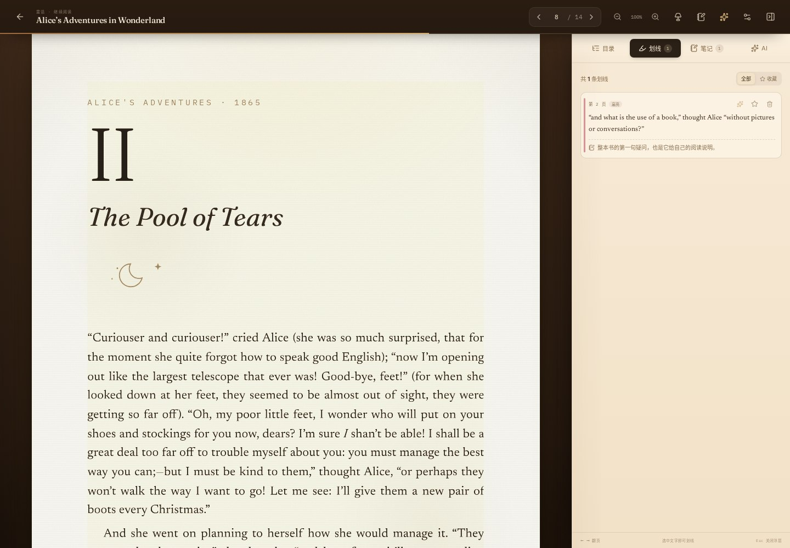
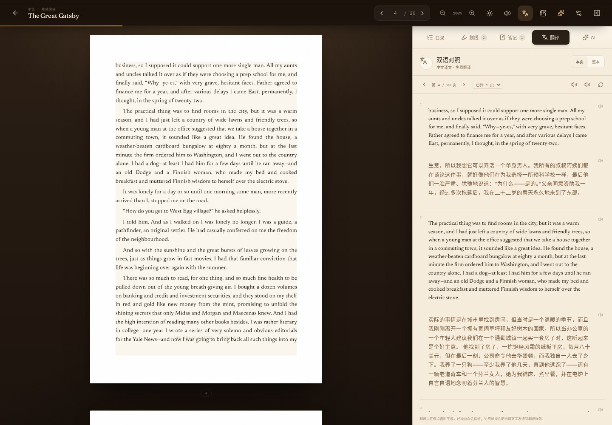
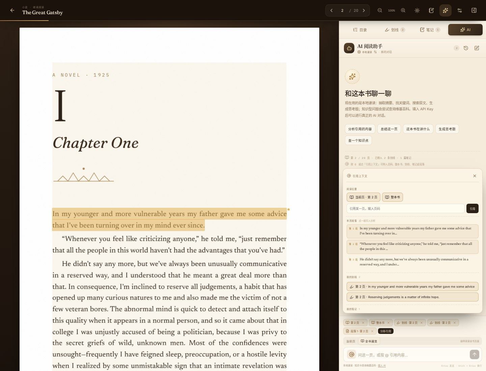

# PageCat · 一间安静的数字书房








> 把 PDF 放上书架，划线、收藏、记笔记，再和 AI 助手一起把一本书读深。

PageCat 是一个**完全运行在浏览器里**的 PDF 阅读空间。它没有账号、没有云端、没有推荐算法：PDF、划线、笔记和阅读进度都只保存在本机的 IndexedDB 中。书架用 CSS 做了拟物化的木纹、书脊与取书动画，阅读页则尽量保留纸书的排版与温度。

## 功能

- **上传 PDF**：拖入窗口或点击「放入新书」；自动读取页数、元数据，并用第一页生成封面。
- **书架拟物交互**：不同颜色、厚度、高度的书脊；悬停抬起、右键/长按整理、点击取书并翻开封面的过场动画、阅读进度书签与一只会互动的书架猫。
- **在线阅读**：pdf.js 高清渲染、文本层选择、连续滚动、缩放、目录跳转、阅读进度、页内页码。
- **划线收藏**：选中文字后浮出工具条，支持四种高亮颜色、下划线、收藏；高亮按 PDF 坐标归一化保存，缩放/换页不会错位。
- **笔记**：可以给划线附笔记，也可以在任意页单独记笔记；两个面板互相跳转，删除划线会级联删除其笔记。
- **AI 阅读助手**：
  - **多会话**：每个会话独立保存，可随时新建、切换、删除和回看历史会话。
  - **@ 引用上下文**：通过 `@` 或「引用上下文」可以引入当前页、任意页码、整本书、某条划线、某条笔记，或本页的某一段落；AI 回答会围绕引用展开。
  - **段落分析**：在书页中选中一段，或在引用菜单里点选某一段，直接让 AI 分析含义、结构和写法。
  - **知识点查询**：本地速读模式下，概念/背景型问题会查询维基百科并明确标注为书外知识卡；接入大模型后可进行完整的通用知识问答。
  - **本地速读（无需密钥）**：抽取摘要、找关键词、按关键词找原文、生成思考题；不调用大模型，明确标注。
  - **在线对话（BYOK）**：填入任意 OpenAI 兼容接口的地址、模型和 API Key，即可流式对话。助手会带上当前页、相邻页、目录、引用、划线和笔记；引用原文时标注页码，可点击跳转。
- **双语翻译**：选中文字即可翻译；翻译卡片可拖动并保留完整原文，侧栏「翻译」支持本页与整本按页对照，英文原文在上、中文译文在下。翻译只在点击后生成，滚动不会自动消耗额度；已译页面会保留在历史和缓存里，可随时查看，只有主动重新翻译才会再次请求。接入 AI 时使用你的接口，未配置时使用免费翻译。
- **语音朗读**：用浏览器语音朗读本页原文或译文，支持暂停、继续和停止；选中文字、译文段落也可以单独朗读。
- **整页阅读**：缩放只作用于 PDF，右侧 AI/翻译栏保持原大小；100% 默认适应一整页。
- **阅读灯光**：纸白 / 羊皮纸 / 夜读三种主题；羊皮纸带有纸纹、暖色灯光和页边晕染，设置里点击即实时切换，并提供同步的纸面预览（取消会恢复原主题）。
- **自由整理书架**：按住书脊拖动，就能在同一层插入到任意位置，或拖到另一层重新摆放；拖动时会显示发光的金色插入线。层数会随藏书数量自动增加，每层最多可放 12 本，所有书都会上架，不再把第 9 本藏进抽屉。顺序和分层保存在本机，刷新后仍然保留。
- **可移动书架饰品**：猫和盆栽（连同旧书堆）都有拖动把手，可以放到任意一层、任意位置，也可以拖到书柜顶部的台面上；把猫和盆栽移开后，第一层就能继续放满书。饰品位置保存在本机。
- **重复书籍识别**：导入时用文件哈希和原有文件信息判断重复；同一本书不会重复上架，历史上已经存在的重复副本会自动清理并给出提示。
- **书架细节**：悬浮卡片通过固定图层显示，不再被隔板裁切；上传区的云朵图标与书本居中对齐。长书名会自动缩短为适合书脊的单列标题，完整书名仍可在悬浮卡片中看到；阅读书签加宽并居中悬挂在书脊顶部。
- **书架猫（桌面宠物）**：会打盹、呼吸、眨眼、摇尾巴、竖耳朵；鼠标靠近会醒来并看向光标。单击摸猫、双击伸懒腰，推毛线球陪它玩，或用小鱼干喂它；猫会用气泡回应，被摸时会冒爱心。移动端也会出现，并给出触摸提示。
- **本地优先**：所有数据只存在浏览器；清空浏览器数据或换设备时需要重新放入 PDF。AI 聊天按会话保存在 IndexedDB 中。

## 预览

自动部署在 GitHub Pages：

**https://boboloveai.github.io/pagecat-preview/**

> 预览站点是静态站点。在线 AI 需要你在「书房设置」里填入自己的 API Key；不填也能使用本地速读和维基百科知识卡。密钥只保存在你自己的浏览器 localStorage 中。

## 本地运行

要求 Node 22.13+ 或 24（项目在 Node 24 下开发）。

```bash
pnpm install
pnpm dev        # http://localhost:5173
pnpm build      # 产物在 dist/
pnpm preview    # 预览生产构建
```

首次打开会自动放入 6 本示例藏书（英文经典为 Project Gutenberg 公有领域节选，另有一本中文使用手册）。示例 PDF 与封面在首次打开时才按需下载，打开后会缓存在本机。

## AI 配置

1. 打开任意书 → 右上角设置（或在书架右上角打开设置）。
2. 选择 DeepSeek / OpenAI / 自定义，填写：
   - 接口地址：例如 `https://api.deepseek.com` 或 `https://api.openai.com/v1`
   - 模型：例如 `deepseek-chat` / `gpt-4o-mini`
   - API Key
3. 点击「测试连接」，保存后 AI 面板会显示当前模型。

AI 面板右上角可以新建会话或查看历史会话。在输入框输入 `@`，或点输入框左侧的 @ 按钮，可以引用当前页、任意页码、整本书、划线、笔记或本页段落。

接口必须是 OpenAI 兼容的 `POST {baseUrl}/chat/completions`，并允许浏览器跨域请求（CORS）。如果接口禁止浏览器直连，需要自建一个允许 CORS 的代理。密钥在浏览器 localStorage 中明文保存，请只在私人设备使用；PageCat 没有服务器，不会收到你的密钥或聊天内容。本地模式的知识卡会把检索词发给维基百科，但不会发送书名、正文或笔记。

## 快捷键

| 键 | 作用 |
| --- | --- |
| `←` / `→` | 上一页 / 下一页 |
| `+` / `-` / `0` | 放大 / 缩小 / 重置 |
| `N` | 打开笔记面板并聚焦输入框 |
| `A` | 打开 AI 助手 |
| `Esc` | 关闭浮层 / 移动端侧栏 |

## 技术栈与结构

- Vite 8 + React 19 + TypeScript
- pdf.js（pdfjs-dist）渲染 PDF 与文本层
- Zustand 管理书架、批注、对话、设置
- IndexedDB（idb）保存 PDF Blob、书籍元数据、划线、笔记、对话
- 无 UI 框架，全部使用手写 CSS 做书架 / 纸张 / 灯光质感
- AI 接口：浏览器内流式 SSE 解析

```
src/
  components/Shelf/    书架、书脊、取书动画、上传、详情
  components/Reader/   分页渲染、文本层、划线工具条、批注弹层、侧栏
  components/AI/       AI 对话面板（多会话、引用、知识卡）
  lib/                 PDF、IndexedDB、选区几何、AI 本地速读 / 在线流式 / 维基百科知识卡
  state/               Zustand stores
  pages/               书架页 / 阅读页
scripts/
  make-books.mjs       示例 PDF 与封面生成器（可复现）
  mock-ai.mjs          本地 OpenAI 兼容 mock，用于验证流式对话
  deploy-preview.sh    构建并部署到 GitHub Pages 预览仓库
```

## 示例藏书来源

示例书架中五本英文节选来自 [Project Gutenberg](https://www.gutenberg.org/) 的公有领域文本，排版、封面与中文使用手册由 PageCat 制作，仅用于阅读与功能演示：

- *The Great Gatsby* — F. Scott Fitzgerald（Project Gutenberg #64317 / Standard Ebooks）
- *Pride and Prejudice* — Jane Austen（#1342）
- *The Art of War* — Sun Tzu, Lionel Giles translation（#132）
- *Meditations* — Marcus Aurelius, George Long translation（#2680）
- *Alice’s Adventures in Wonderland* — Lewis Carroll（#11）

生成命令：

```bash
node scripts/make-books.mjs
```

> 需要 Playwright Chromium 与中文字体；生成文件已随仓库提交，日常开发无需重新生成。

## 部署

```bash
./scripts/deploy-preview.sh
# 或指定预览仓库
PREVIEW_REPO=your-name/your-preview ./scripts/deploy-preview.sh
```

脚本会构建、把 `dist/` 推送到预览仓库的 `gh-pages` 分支，并在需要时启用 GitHub Pages。

## 已知限制

- 在线 AI 依赖第三方接口与浏览器 CORS；无密钥时只有本地速读与维基百科知识卡，不具备大模型的语义理解和生成能力。
- 知识卡依赖维基百科网络可达；在无法访问维基百科的网络环境中会退回到书内速读。
- 免费翻译会把当前文字发送到翻译服务，并受每日额度限制；整本翻译建议接入 AI。语音朗读使用浏览器的 Web Speech API，依赖系统是否安装可用语音。
- 段落提取按行距近似切分；复杂排版（多栏、学术脚注）可能不如人工选择准确，可以直接选中文字代替。
- 书页按第一页比例占位；极少见的混合尺寸 PDF 在滚动到该页时会重新排版。
- 所有数据都是本地的，没有跨设备同步；清空浏览器站点数据会删除书架。
- 示例书为节选，用于展示功能；完整文本请前往 Project Gutenberg 阅读。
